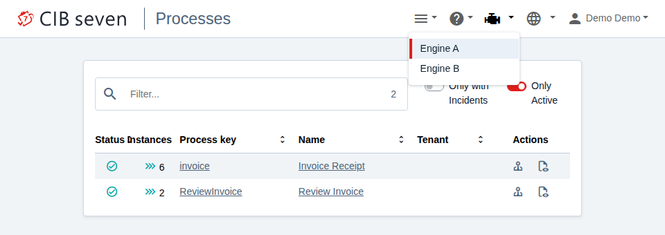
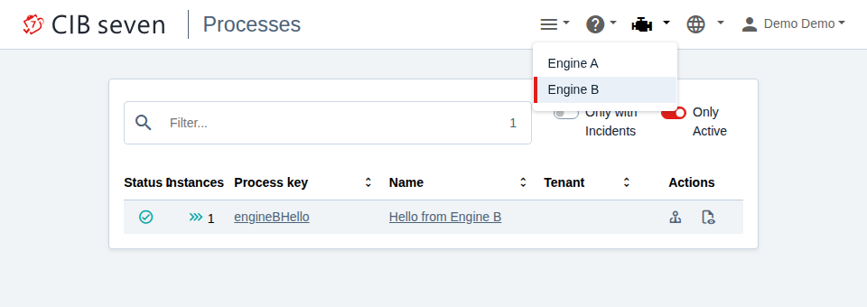

# CIB seven 2.2.0 – Multi-Engine with Docker Compose

One CIB seven webclient displays and operates two separately running engines (separate containers, separate databases). You switch between them using the engine selector in the top menu of the webclient.

```
Browser ──► engine-a :8080   webclient + REST API + invoice example
               │
               └── server-side ──► engine-b :8080   REST API only, process "Hello from Engine B"
                                   (also reachable from the host on :8081)
```

Multi-engine support has been part of the Community Edition since CIB seven 2.1.0. The example therefore uses the public image `cibseven/cibseven:run-2.2.0`; it works the same way with the Enterprise image (variable `CIBSEVEN_IMAGE` in `.env`).

## Getting started

```bash
./generate-secrets.sh        # creates .env with two random JWT secrets
docker compose up -d --wait
./smoke-test.sh
```

Then open `http://localhost:8080/webapp` in the browser, log in with `demo` / `demo` and select "Engine B" in the top menu. Engine B hosts the process "Hello from Engine B", Engine A hosts the invoice example.





`.env` is excluded from the repository via `.gitignore`. To generate new secrets, run `./generate-secrets.sh`, then `docker compose up -d --force-recreate --wait`.

## The relevant configuration

### 1. Register additional engines in the webclient

`engine-a/multi-engine.yml`:

```yaml
cibseven:
  webclient:
    engineRest:
      url: http://localhost:8080
      path: /engine-rest
      displayName: Engine A
      additionalEngineRest:
        - url: http://engine-b:8080
          path: /engine-rest
          displayName: Engine B
          jwtSecret: ${ENGINE_B_JWT_SECRET}
```

The webclient fetches the engine list from each entry via `GET {url}{path}/engine` and merges the results. If a REST API provides several named engines, all of them appear (displayed as e.g. "Engine B (production)").

The file is loaded in addition via `-Dspring.config.additional-location`. This leaves the bundled `default.yml` unchanged and overrides only these values.

### 2. Authentication: one JWT secret per engine

Both engines run with composite authentication (JWT, fallback to HTTP Basic):

```yaml
CAMUNDA_BPM_RUN_AUTH_ENABLED: "true"
CAMUNDA_BPM_RUN_AUTH_AUTHENTICATION: composite
```

At login, the user selects an engine. The webclient signs the token with the secret of exactly that engine and sends it with every REST call. The engine validates it with its own secret. This results in:

| Where | Value |
|---|---|
| Engine A (container `engine-a`) | `CIBSEVEN_WEBCLIENT_AUTHENTICATION_JWTSECRET` = secret A |
| Engine B (container `engine-b`) | `CIBSEVEN_WEBCLIENT_AUTHENTICATION_JWTSECRET` = secret B |
| Webclient, entry for Engine B | `additionalEngineRest[].jwtSecret` = secret B |

Secret requirements: at least 155 characters and Base64-decodable (alphanumeric is sufficient).

Important: the engine reads its secret only from the environment variable `CIBSEVEN_WEBCLIENT_AUTHENTICATION_JWTSECRET`, from the JVM system property `cibseven.webclient.authentication.jwtSecret`, or from `cibseven-webclient.properties` on the classpath, not from `application.yaml` or `default.yml`. The environment variable is therefore the simplest option; the webclient in the same container reads it as well.

If no secret is set, CIB seven Run generates a random secret per instance in `configuration/userlib/cibseven-webclient.properties` on first start. Two instances then automatically have different secrets, and the webclient does not know the secret of the other instance.

### 3. Users

Login happens per engine. The user must exist on each engine and be authorized there. In this example, the `default.yml` of CIB seven Run creates `demo` / `demo` on both engines.

## Common problems

| Symptom | Cause | Solution |
|---|---|---|
| Engine B is missing from the selector; the engine-a log shows `Failed to fetch engines from additional URL` | The URL is not reachable from the webclient server. Often `localhost` or a hostname that only resolves in the browser. | Specify the URL as seen from the webclient server (in Docker: the service name). CORS does not matter, because the browser does not call the engine directly. |
| Engine B appears, but login or any action there ends with 401 | `jwtSecret` is missing from the entry or does not match the secret of Engine B. Without the entry, the webclient uses the secret of Engine A. | Set the same value in `additionalEngineRest[].jwtSecret` and in the environment of Engine B. |
| Secret "set", but still 401 | Secret only maintained in `application.yaml`; the engine keeps using the random value from `cibseven-webclient.properties`. | Set the secret via environment variable or system property. |
| Webclient does not start or login fails, log shows "Secret must be at least 155 characters long and a base64 decodable string" | Secret too short or contains characters that are not Base64. | Use at least 155 alphanumeric characters. |
| Webclient requests are rejected by the engine although the secrets match | Composite authentication enabled together with `--oauth2`. | Do not combine them (see the CIB seven Run documentation). |
| Engine B does not show up in the classic Cockpit (`/camunda/app/cockpit`) | The Camunda webapps only see engines in the same JVM. | For multi-engine across several servers, use the CIB seven webclient at `/webapp`. |

## Applying this to other distributions

The webclient properties (`cibseven.webclient.engineRest.*`) are the same in all distributions. The only differences are where the configuration lives and how authentication is enabled:

- CIB seven Run: as in this example.
- Tomcat / WildFly: webclient configuration in the `application.yaml` of the webclient; enable the composite filter in the `web.xml` of the REST API (see "Configure Authentication"); secret via environment variable.
- Spring Boot: properties in the `application.yaml` of the application; secret via environment variable.

For production use, the secrets come from a secret store, the engines run against an external database (`SPRING_DATASOURCE_*` or `DB_*`), and the webclient talks to the engines over HTTPS.

## Sources

Documentation (2.2):

- Webclient configuration, section "Multi-engine support": https://docs.cibseven.org/manual/2.2/webapps/configuration-options/
- REST API authentication (composite, JWT secret): https://docs.cibseven.org/manual/2.2/reference/rest/overview/authentication/
- CIB seven Run (options, `camunda.bpm.run.auth.*`): https://docs.cibseven.org/manual/2.2/user-guide/cibseven-run/
- Docker images: https://docs.cibseven.org/manual/2.2/installation/docker/

Source code, tag `v2.2.0`:

- Webclient, configuration model: `cibseven-webclient` → `cibseven-interfaces/src/main/java/org/cibseven/webapp/config/EngineRestProperties.java`, `EngineRestSource.java`
- Webclient, fetching the engines: `cibseven-webclient-core/src/main/java/org/cibseven/webapp/providers/EngineProvider.java`
- Webclient, secret per engine: `cibseven-webclient-core/src/main/java/org/cibseven/webapp/auth/utils/EngineTokenUtils.java`
- Engine, reading the secret: `cibseven` → `engine-rest/engine-rest/src/main/java/org/cibseven/bpm/engine/rest/security/auth/impl/jwt/Configuration.java`
- Run, random secret on startup: `cibseven` → `distro/run/assembly/resources/run.sh`
- Docker image, startup script: `cibseven-docker` → `cibseven-run.sh`

## License

Apache License 2.0, see `LICENSE`.
